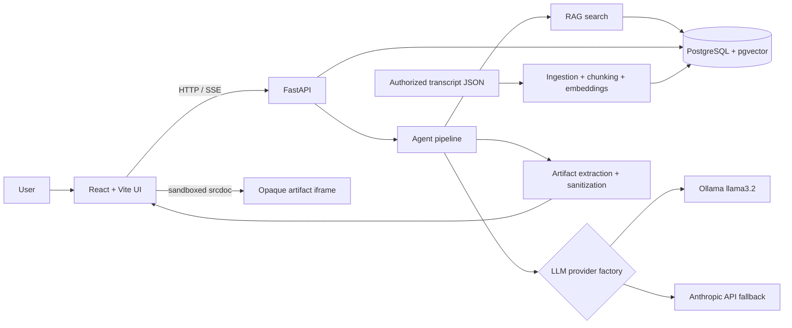

# Architecture

## System Diagram

## Runtime Components

- **Frontend:** React 19, TypeScript, Vite, and Lucide. The app is located at the repository root. Chat uses SSE; history and health use JSON endpoints.
- **API:** Python 3.11, FastAPI, Pydantic v2, SQLAlchemy async sessions, and HTTPX provider clients.
- **Database:** PostgreSQL 16 with the pgvector extension. AsyncPG is the PostgreSQL driver. SQLite/aiosqlite is used only for isolated tests.
- **Models:** Ollama is the default local provider. The factory falls back to Anthropic when configured; if neither can answer, the API emits an HTTP or SSE error.

## Data Model

| Table | Main columns | Purpose |
|---|---|---|
| `users` | `id`, nullable unique `email`, `created_at` | Optional user relation; authentication is outside the demo scope. |
| `sessions` | `id`, nullable `user_id`, `title`, `created_at`, `updated_at` | Conversation containers. |
| `messages` | `id`, `session_id`, `role`, `content`, JSON `metadata`, `created_at` | Persisted user and assistant turns; metadata includes provider/model and citations. |
| `transcript_chunks` | `id`, `source_id`, `title`, `speaker`, `timestamp`, `url`, `content`, `chunk_index`, `embedding vector(384)`, `created_at` | Searchable transcript excerpts and source context. |

Messages cascade-delete with their session. `sessions.user_id` is nullable and uses `ON DELETE SET NULL`. Transcript `source_id` is stable for title and URL, so re-ingestion replaces the same source's chunks.

## Ingestion Workflow

1. `POST /api/ingest` validates 1-100 transcript records. Each record has a title, content, optional speaker/timestamp/URL.
2. Content is whitespace-tokenized into configurable chunks (default 700 words, 100-word overlap). This is a practical approximation, not model-token counting.
3. A deterministic normalized hashed-token vector is generated for each chunk. It keeps the local demo self-contained; it is not a substitute for an evaluated semantic embedding model.
4. Existing chunks with the same stable source ID are deleted, new chunks are inserted, and the transaction commits. PostgreSQL retrieval uses pgvector cosine distance; SQLite tests use lexical overlap plus vector similarity.
5. The Docker backend seeds only the clearly synthetic demo records at startup. Do not treat them as real podcast material.

## Retrieval and Agent Workflow

1. Validate session and message, load recent conversation history, and retrieve only chunks that pass lexical-overlap or cosine-similarity relevance thresholds.
2. The default `quote` mode selects a relevant source sentence and returns it verbatim with transcript title, speaker, timestamp, and URL. It does not call an LLM. If no sentence matches, it abstains.
3. The `answer`, `essay`, and `artifact` modes build provider prompts with source metadata and excerpts. Transcript content is explicitly treated as untrusted data, not instructions. The essay mode adds the Ship 30 for 30 structure; artifact mode extracts fenced HTML/code or returns Markdown.
4. The provider factory tries the requested provider, then its counterpart. Anthropic is skipped when no key is configured. The generated modes can still make mistakes; citations do not prove every generated claim.
5. Persist both turns and citation metadata, then stream token batches, citations, optional artifact, and completion/error events.

## Artifact Security

The API applies server-side HTML filtering. The UI parses preview markup, removes executable/embedding elements and event attributes, and renders `srcdoc` in an iframe with an empty `sandbox` attribute (opaque origin; no scripts, forms, or top navigation). The document applies a restrictive CSP: no default sources, inline styles only, and data images only. Do not add iframe permissions casually; add sanitizer tests before broadening allowed markup.

## Operational Boundaries

Compose starts PostgreSQL, Ollama, pulls the configured local model, seeds synthetic data, then starts API and UI. Persist database and Ollama data in named volumes. The included configuration is a local single-tenant demo, not a public production perimeter; authentication, authorization, TLS, rate limiting, backup policy, and observability are deployment responsibilities.
